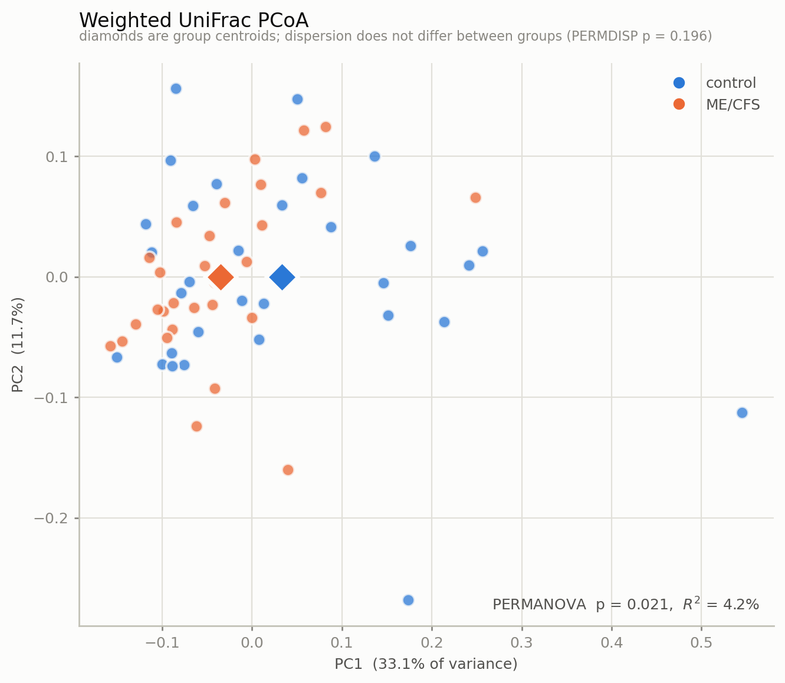
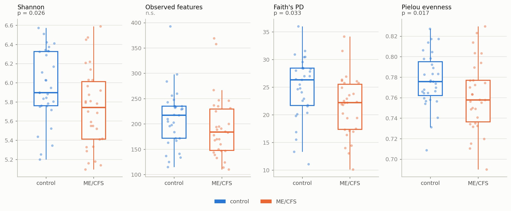
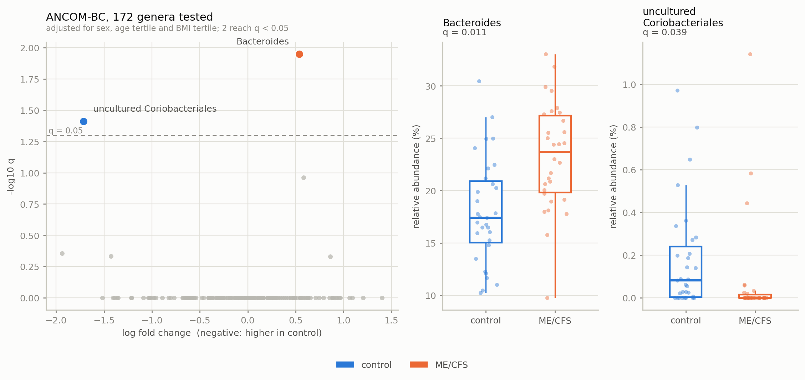
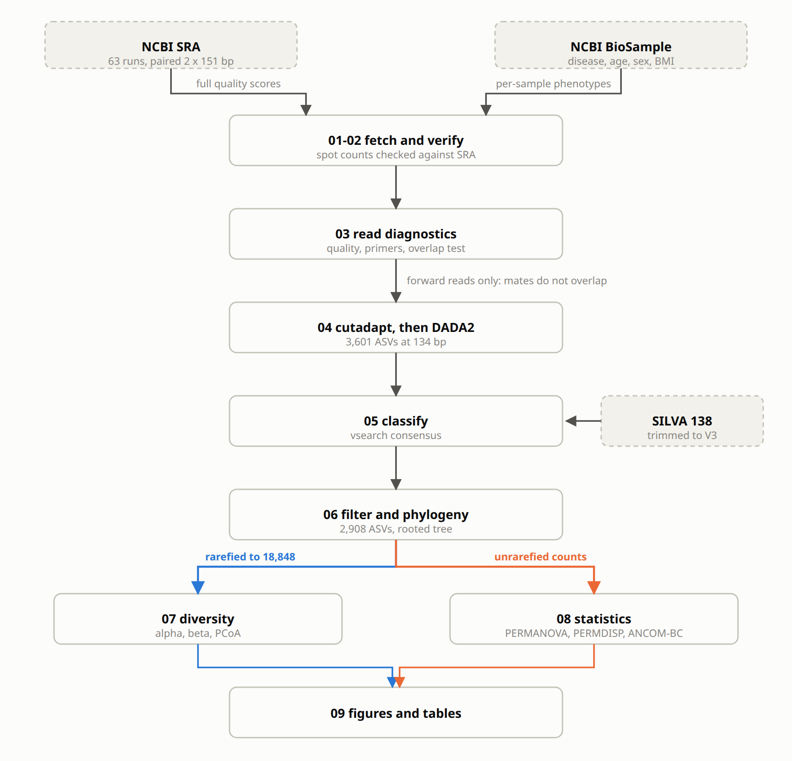

# ME/CFS gut microbiome: a 16S amplicon analysis

A reproducible reanalysis of 61 stool samples from people with myalgic encephalomyelitis /
chronic fatigue syndrome and matched healthy controls, built as a Snakemake workflow around
QIIME 2 and DADA2.

<picture>
  <source media="(prefers-color-scheme: dark)" srcset="results/figures/pcoa_weighted_unifrac_dark.png">
  
</picture>

## What it found

**Gut bacterial communities differ between the two groups, but the effect is small.**

Diversity *within* each sample is lower in ME/CFS. Shannon diversity differs at p = 0.026,
and the same direction holds across every diversity measure tested.

Community *composition* differs too. PERMANOVA on UniFrac distances is significant for both
the weighted (p = 0.021) and unweighted (p = 0.033) versions, and the difference survives
adjustment for age, sex and BMI. But disease status explains only **2 to 4% of the variation
between samples**, so this is a real signal rather than a large one. Age explains about as
much.

At the genus level, two of 172 genera differ: *Bacteroides* is higher in ME/CFS, and an
uncultured genus in the family Coriobacteriales Incertae Sedis is higher in controls.

<picture>
  <source media="(prefers-color-scheme: dark)" srcset="results/figures/alpha_diversity_dark.png">
  
</picture>

<picture>
  <source media="(prefers-color-scheme: dark)" srcset="results/figures/differential_abundance_dark.png">
  
</picture>

Two details that change how those results should be read:

**One of the four distance measures is not what it looks like.** Jaccard gives the strongest
PERMANOVA (p = 0.005), but PERMDISP is also significant (p = 0.018), meaning the two groups
differ in how spread out they are, not only in where they sit. PERMANOVA cannot tell those
apart, so that result is reported as a **difference in variability**: ME/CFS samples differ
more from each other in which taxa are present. The UniFrac results have no such problem.

**The second genus is about presence, not abundance.** That taxon is near zero in almost
every ME/CFS sample while controls range from 0 to 1%. Calling it "lower in ME/CFS" implies
a change in amount, which is not what the data shows.

## The data

[BioProject PRJNA1332076](https://www.ncbi.nlm.nih.gov/bioproject/PRJNA1332076), 63 runs,
Illumina iSeq 100, 16S V3-V4 with the 341F/805R primers. Nothing is included in this
repository; the workflow downloads it.

Disease status, age, sex and BMI are recorded per sample on the BioSample records, so the
workflow builds its metadata table straight from the archive rather than from a supplementary
file.

It is a **matched design**, verified rather than assumed: median age 55
against 52, median BMI 23.9 against 24.6, and 58% against 57% female. That matching is why
adjusting for those covariates barely moves the result.

Final analysis set: **61 samples, 31 control and 30 ME/CFS**.

## Known pitfalls

Each of these produces a wrong result without producing an error, which is why they are
worth stating.

> **Do not download from the obvious place.** SRA stores two versions of every run, and
> "SRA Lite" replaces every quality score with one constant. Both the `trace.ncbi.nlm.nih.gov`
> FASTQ endpoint and the `download_path` column in SRA's run table serve Lite. DADA2 fits its
> error model to quality scores, so Lite data gives you bad ASVs and no error message. This
> workflow pulls from the S3 object store, which keeps the real scores.

> **Do not merge the paired reads.** The amplicon is about 460 bp and the reads are 2 x 151,
> so roughly 160 bp in the middle was never sequenced. Measured on 1,000 real pairs, 1.0%
> overlap, which is chance. DADA2's merge step does not fail on non-overlapping reads. It
> discards almost everything and reports success. Forward reads only.

> **Two libraries failed.** Two samples have 219 and 323 reads against a next-shallowest of
> 20,848. Both are controls, and both are excluded.

> **Rarefying does not remove the depth effect.** With every sample rarefied to the same
> depth, original depth still predicts observed richness (Spearman 0.40), because DADA2 calls
> ASVs before rarefying and deeper samples yield more of them. Shannon is unaffected (0.05),
> which is why it carries most weight here.

## Running it

Two conda environments are needed. One for QIIME 2, one with `sra-tools` for the download
step. Each Snakemake rule names its own, so it does not matter which one you launch from.

```bash
# QIIME 2, from the official distribution
conda env create -n qiime2-amplicon-2025.7 \
  --file https://raw.githubusercontent.com/qiime2/distributions/dev/2025.7/amplicon/released/qiime2-amplicon-ubuntu-latest-conda.yml

# sra-tools, for the download step only
conda env create -f environment-sra.yml

snakemake -n                                 # dry run, always first
snakemake --cores 4
```

If your environments have different names, change them in `config/config.yaml` under
`environments`.

Set an email address for NCBI, which asks automated clients to identify themselves:

```bash
export NCBI_EMAIL="your.address@example.com"
```

Expect about 315 MB of reads and 100 MB of SILVA reference to download, and roughly half an
hour of compute on a laptop. Every step skips work whose output already exists, so an
interrupted run picks up where it stopped.

## What the workflow does

<picture>
  <source media="(prefers-color-scheme: dark)" srcset="results/figures/workflow_dark.png">
  
</picture>

The split near the bottom is the part worth looking at. Diversity measures are sensitive to
sequencing depth, so that branch is rarefied. ANCOM-BC models compositionality and library
size itself, so feeding it rarefied counts would throw away two thirds of the reads for
nothing. Rarefying everything is a common and avoidable mistake.

| step | what happens |
|---|---|
| 01 | fetch run table and per-sample metadata, write the QIIME 2 metadata file |
| 02 | download reads, convert, verify each one by spot count |
| 03 | read quality, primer detection, and the overlap test |
| 04 | import, trim primers with cutadapt, denoise to ASVs with DADA2 |
| 05 | assign taxonomy against SILVA 138 |
| 06 | remove contaminants, build the phylogeny |
| 07 | rarefy, alpha and beta diversity, ordinations |
| 08 | Kruskal-Wallis, PERMANOVA, PERMDISP, adonis, ANCOM-BC |
| 09 | figures |

Every decision and the reasoning behind it is in [`config/config.yaml`](config/config.yaml).
It is worth reading if you want to know why a parameter has the value it has.

## Using it on a different dataset

The workflow is tied to this BioProject by configuration, not by code. To point it at
another 16S study, edit [`config/config.yaml`](config/config.yaml):

| change | where |
|---|---|
| the accession | `dataset.bioproject`, plus `expected_runs` and `expected_groups` |
| which BioSample fields become metadata columns | `biosample.attribute_map` |
| the group labels in `host_disease` | `biosample.group_labels` |
| your primer sequences | `primers` |
| read length and amplicon length | `dataset` |
| the formulas | `statistics` |

Then run `snakemake` and read what step 03 tells you. It measures read quality, detects your
primers and tests whether the mates overlap, and it prints the truncation length and the
merge decision rather than assuming either. Those two are the parameters most likely to be
wrong when a 16S pipeline is reused.

Two things will not transfer. The exclusion of the two failed libraries is specific to this
data, so check the depth table from step 06 for yours. And the covariates are hard-wired to
age, sex and BMI, which are what this cohort records.

If your reads do overlap, which most V3-V4 runs at 2 x 250 or 2 x 300 will, the denoising
step needs `denoise-paired` rather than `denoise-single`. That is a change to
`scripts/04_denoise.py`, not a config value.

## Limitations

**Taxonomic resolution is capped by the sequencing design.** With 134 bp of the V3 region,
genus is the realistic ceiling. The classifier does report species-level assignments, but
they should not be trusted and are not used; all testing is done at genus level.

**61 samples is modest.** Effects of the size seen here are detectable but leave little room
for subgroup analysis, and a null result on any single measure would not mean much either
way.

**ME/CFS microbiome findings are contested**, with published studies disagreeing. This is one
dataset analysed one way. The point of the repository is that every choice is visible and the
whole thing re-runs from accession numbers.

**No publication is linked to this BioProject**, so there are no published results to compare
against. The analysis stands on its own methods rather than on reproducing someone else's.

## Repository layout

```
config/config.yaml     every parameter, with the reasoning
scripts/               nine steps, each a standalone argparse command
Snakefile              wires them together
metadata/              sample metadata built from the archive
results/tables/        all numeric results
results/figures/       figures, light and dark
```

`data/`, `reference/` and the QIIME 2 artifacts are not committed. They are downloaded or
regenerated by the workflow.

## Software

QIIME 2 2025.7, DADA2, cutadapt, vsearch, MAFFT, FastTree, ANCOM-BC, SILVA 138, Snakemake.
Citations for each are available through `qiime <plugin> --citations`.

## Author

**Muhammad Ahsan Rafi**
M.S. Industrial Biotechnology, Atta-ur-Rahman School of Applied Biosciences (ASAB),
National University of Sciences and Technology (NUST), Islamabad.

[github.com/ahsan-omics](https://github.com/ahsan-omics)

## Licence

MIT. See [LICENSE](LICENSE).
